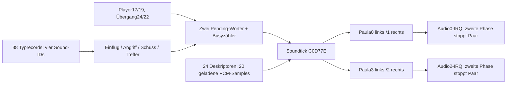

# Originale Vyper-Soundengine – Issue67

**Reiner Analyseauftrag**, Branch `analysis-amiga-sound`, Basis `f7350d6`
(Merge des getesteten Stage7b5b). Kein Spielcode, DAT, PRG, D81, Tag oder
Stable-Stand wird geändert. Kein neuer Spielbuild und kein Merge.

**Ergebnis:** Vyper spielt rohe8-Bit-PCM-Daten aus `Vyper:sonquasar` ab.
24 Samplebeschreibungen sind vorhanden,20 werden tatsächlich geladen. Zwei
logische Klangplätze verwenden je ein Paula-Stereopaar. Die38 Gegnertypen
besitzen jeweils vier Soundkennungen, teilen sich aber **sechs** Zerstörungssamples.
Der Player hat eine eigene Explosionskennung19. Die lange Übergangsfolge ruft
PCM-Kennung24 und anschließend22 auf; kein Notensequencer ist dafür nachgewiesen.

## Evidenzgrade und Grenzen

- **Bestätigt (statisch):** Instruktionsbytes/Tabellen und Datenfluss durch den
  Originalcode, mit Bytevergleich in ADF und beiden gespeicherten RAM-Kopien.
  Dies ist kein akustischer WinUAE-Laufzeitnachweis.
- **Stark gestützt:** Interpretation als einmalige PCM-Effekte mit räumlichem
  Panning; Übereinstimmung aus Loader, Paula-Start, IRQ-Abschaltung und Samplebytes.
- **Hypothese:** mögliche Bedeutung unbeobachteter Restbytes oder Varianten.
  Hier wird diesen ausdrücklich keine erfundene Funktion zugewiesen.
- **Offen:** genaue native Gameplay-Updatefrequenz, tatsächliche Unterbrechungen/
  Überlagerungen beim Levelwechsel, analoge Filter und Hörvergleich.

Die Daten stammen aus dem vorhandenen Originalpaket:

| Datei | Bytes | SHA-256 |
|---|---:|---|
| `VYPER.ADF` |901120|`b28cab911431aaf3e48fd3e9979159de7154f98538eeba191f52ac47ef9665e5`|
| `Vyper_Memory_Dump.dat` |524288|`d74aea88fb4232e36caab80e51abc51f73d470a5b55a54f5cb010f1d910ddf8c`|
| `Vyper_Startscreen.uss` |1076832|`d836cbf88f0ac35b6ed3776df2add39f699113c1aeb9d02cdfe4651c82793916`|

Alle drei Checksummen werden vor jeder Analyse geprüft. Das OFS-Startup enthält
`shot`; `/Vyper/Shot` ist ein81432-Byte-HUNK-Programm, **kein Schusssample**.
`/Vyper/vyper` ist ein anderes81432-Byte-Programm; seine CODE-Daten unterscheiden
sich an8134 Bytes. `/Vyper/a` ist kein unbenanntes HUNK_HEADER-Abbild. Diese Dateien
werden inventarisiert, aber nicht fälschlich als die laufende Shot-Kopie behandelt.
Das erklärt auch, weshalb Dateinamen allein nicht als Soundereignisse taugen.

Die OFS-Verzeichnis-/Dateiheader und die Dateiketten der ausgewählten Quellen
werden inklusive Blockchecksummen geprüft. Der Datenträger enthält daneben einen
unbenannten/aus Leerzeichen bestehenden, nicht benötigten Dateieintrag mit erstem
Datenpointer11. Dessen Datenkette wird nicht verwendet; es wird **keine vollständige
Integrität sämtlicher fremder Diskettendateien** behauptet. Sounddatei und Programm
werden ohne Abschwächung ihrer Prüfsummen-/Kettenprüfung extrahiert.

## Adressen und reproduzierbarer Nachweis

| Abbildung | CODE | DATA | A4 |
|---|---|---|---|
| USS-BRAM/CRAM |`$C08760`|`$18140`|`$2013E`|
| ChipRAM-Dump |`$21B20`|`$2AF50`|`$32F4E`|

CODE-Dateioffset in Shot `$28`, DATA-Dateioffset `$9918`.
CODE-Offset = USS-Codeadresse−`$C08760`; Dump-Adresse = CODE-Offset+`$21B20`.
Für Daten: Shot-Offset=`$9918`+DATA-Offset. Das Skript ermittelt/prüft die
HUNK_RELOC32-Basen, statt absolute Pointer zwischen Abbildern gleichzusetzen.

22 Spannen mit1121 vollständig dekodierten68000-Instruktionen stimmen nach
Relokation mit **beiden** RAM-Abbildern überein. Jede Instruktion mit USS-/Dump-
Adresse, CODE-/Dateioffset und Bytes steht in
[`amiga_sound_evidence/68000-excerpts.txt`](amiga_sound_evidence/68000-excerpts.txt).
[JSON-Evidenz](amiga_sound_evidence/evidence.json) enthält auch Samplepointer,
Dateiketten, Tabellen, Aufrufer, Copperlisten und Grenzen des Nachweises.
Außerhalb der geprüften Spannen besteht kein Anspruch auf vollständige
Identität des gesamten CODE-Hunks.

## Routinen und Aufrufer

| Funktion | USS-Adresse | CODE-Offset | Aufrufer/Verwendung |
|---|---|---|---|
| Soundinitialisierung/Dateilader |`$C0E820`|`$60C0`|`$C09B00`|
| Zwei logische Klangplätze zurücksetzen |`$C0A286`|`$1B26`|`$C08F1A`|
| Gegner-Typfelder übernehmen |`$C0A9B2`|`$2252`|Levelinitialisierung|
| Zentraler Soundtick |`$C0D77E`|`$501E`|`$C0D094` und bedingt `$C0D01A`|
| Gameplay-Update |`$C0D08C`|`$492C`|Hauptschleife; Soundtick vor neuen Ereignissen|
| Copper-Server |`$C0CFF2`|`$4892`|Exec AddIntServer, Interruptnummer4 (COPER)|
| Audio0-Callback |`$C0EAE8`|`$6388`|Exec SetIntVector Nummer7 (AUD0)|
| Audio2-Callback |`$C0EB16`|`$63B6`|Exec SetIntVector Nummer9 (AUD2)|
| Soundbereinigung |`$C0EA66`|`$6306`|`$C0C430`; Vektor-Restore-Versuch (siehe unten), Speicher freigeben|



`direct_callers` im JSON listet die direkten JSR-Adressen/Bytes. Die Suche nach
Paula-Literalen dekodiert zusätzlich an geraden CODE-Offsets je eine Instruktion:
Dies sind **Kandidaten**, kein pauschaler Nachweis ausführbaren Codes. Für die
bestätigten Audiozugriffe werden nur die vollständigen geprüften Spannen benutzt.
Die ebenfalls gefundenen DMACON-Schreibungen mit Masken`$20/$8020` betreffen
Sprites und sind keine Samples. Bekannte indirekte Zugriffe über A2 bzw. die
Exec-Callbackbasis A0 sind separat im vollständigen Disassembly enthalten.

Die früher genannte Dump-Adresse`$26B48` ist Teil des Adressoperanden der
LEA-Instruktion bei`$26B46` (USS`$C0D786`), kein Routinenanfang. Der Bereich
`$311E–$3262` liegt außerhalb des nachgewiesenen Spiel-CODE-Hunks. Darin gefundene
Registeradressen beweisen ohne OS-/Datenflussanalyse keine weitere Soundroutine.

## Sounddeskriptoren und echte Sampledaten

**Bestätigt:**24 Deskriptoren à12 Bytes ab DATA+`$020A`:

| Offset | Format | Bedeutung aus dem Code |
|---|---|---|
|+0|WORD BE|Paula PER, konstante Abspielperiode|
|+2|WORD BE|Panningteiler4/6/8|
|+4|WORD BE|Samplelänge in Paula-Wörtern, also2×Bytes|
|+6|WORD BE|Busy-/Zulassungssperre in Soundticks|
|+8|LONG BE|zur Laufzeit alloziertes MEMF_CHIP-Sample, im Datei-HUNK0|

Adresse im USS=`$1834A+12*(ID−1)`, im Dump=`$2B15A+12*(ID−1)`.
Der Tick reduziert die1-basierte ID um1 und multipliziert mit12.
Der Lader allokiert mit MEMF_CHIP=`2`, liest jeweils `LEN` Elemente à2 Bytes
und schreibt den Pointer in+8. Bei den IDs4/13/14/23 setzt er den Pointer0 und
überspringt entsprechend viele Dateibytes per Seek. Diese vier Abschnitte sind
auf der Diskette vorhanden, werden von dieser Spielversion aber nicht geladen.

`sonquasar` hat164849 Bytes,
SHA-256 `f281ec5ab8592b4b9575acd364a53e8901ab59ee93dbb8fe89150d6d1ec00931`.
Die Längen beschreiben lückenlos164836 Bytes ab Dateioffset0, danach bleiben13
unverbrauchte Bytes. Keine erfundene Header-/Instrumentenfunktion für diesen Rest.
Geladene20 Samples zusammen154304 Bytes; größtes Sample ID19 mit21546 Bytes.

Die20 tatsächlich geladenen Bytefolgen stimmen **vollständig** mit den Pointer-
Zielbereichen im USS und im separaten Dump überein. Die Originalbytes gehen direkt
an AUDxLC und AUDxLEN; es gibt in diesem Pfad weder IFF-/WAV-Header noch Entpacker,
ADPCM-Dekoder oder Softwaremischer. Zusammen mit Paulas8-Bit-Signed-PCM-Wiedergabe
belegt dies das native Rohsampleformat. Eine16-Bit-WAV-Interpretation der Datei
wäre falsch: WORD ist hier die DMA-Längeneinheit, nicht die Sampleauflösung.

Die vollständige maschinenlesbare Liste enthält pro Sample Länge, Dateioffset,
PER, Panning, Busyzähler, beide RAM-Pointer, Rohdatenhash und bedingte Abspielrate:
[`samples.csv`](amiga_sound_evidence/samples.csv). Darin sind die vier unbenutzten
Abschnitte ausdrücklich markiert. Alle24 Rohabschnitte wurden lokal verlustfrei
nach`/tmp/vyper-original-sounds/` extrahiert; Binärdaten werden nicht erneut ins
Repository kopiert. Das Skript reproduziert sie aus der vorhandenen ADF.

## Paula-Start, Stereo, Dauer und Prioritäten

**Bestätigt:** Es gibt zwei12-Byte-Laufzeitzustände bei A4+`$2D4E` und+`$2D5A`:

| Offset | Bedeutung |
|---|---|
|+0|Busy-Countdown, verringert pro Soundtick|
|+2|Pending-ID,0=keine; bei Verarbeitung löschen|
|+4|IRQ-Phase,0→1→2;2 überspringt weitere VOL-Updates|
|+6|Panningteiler des gestarteten Samples|
|+8|Pointer auf ein WORD mit lebender X-Position|

Bei einer Pending-ID schreibt `$C0D7BC–$C0D7D6` beide LEN-, LC- und PER-Register
desselben Paars identisch. DMACON erhält über die CODE-Tabelle`$C0D07E` die Wörter
`$8203` bzw.`$820C`: SETCLR, globales DMAEN und das jeweilige Paar.
Das Spiel hat damit **zwei unabhängige Mono-Samplequellen**, die für Stereo jeweils
zweimal über Paula ausgegeben werden, nicht vier unabhängige Soundereignisse.

Lautstärke ist ein X-abhängiges Panning, keine zeitliche ADSR-Hüllkurve:

```
x = clamp(*position_pointer, 0, 240)
right = floor(x / divisor)
left  = (240 / divisor) - right
```

Die CODE-Bytes bei`$C0D082` liefern die Summen60/40/30 für Teiler4/6/8.
Paar0/1 schreibt `VOL0=left,VOL1=right`; Paar2/3 schreibt
`VOL2=right,VOL3=left`, passend zu Paulas Kanal-Stereoseiten.
Die Sample-Amplitudenhüllkurve steckt in den PCM-Daten. PER wird nur beim Start
und beim Stoppen auf1 geschrieben, kein periodischer Pitch-/FM-Synthesepfad ist
hier nachgewiesen. AUDxDAT und ADKCON werden von den bestätigten Soundroutinen
nicht zur Tonerzeugung verwendet. Eine vollständige Aussage über beliebigen
OS-/selbstmodifizierten Code wäre darüber hinaus nicht belegt.

Audio0- und Audio2-Interrupts überwachen je ein Paar. Nach dem Start setzt der
erste Callback die Phase0→1; der nächste stoppt beide DMA-Kanäle, setzt PER beider
Kanäle auf1, markiert Phase2 und quittiert INTREQ mit`$80/$200`.
Dies implementiert die einmalige Wiedergabe trotz Paulas hardwareseitigem
DMA-Reload. Exakter erster/letzter hörbarer Samplezeitpunkt braucht einen
Paula-Laufzeittrace; das Skript behauptet keine gemessene Analogdauer.
INTENA wird initial mit`$0780` für Audio gelöscht und danach mit`$8280` nur für
AUD0/AUD2 eingeschaltet. Die Bereinigung deaktiviert die verwendeten Interrupts,
stoppt alle vier DMA-Kanäle und gibt die geladenen MEMF_CHIP-Blöcke frei.
**Auffälligkeit im Original:** Beim anschließenden SetIntVector-Restore werden
bei`$C0EA7E/$C0EA8C` die Argumente`$80/$200` (Bitmasken) übergeben, während
die Installation korrekt die Bitnummern7/9 verwendet. Die Bytes stimmen in
ADF und beiden RAM-Kopien überein. Der Wiederherstellungsversuch ist belegt;
eine **korrekte** Vektorwiederherstellung ist damit gerade nicht bewiesen.
Ein ursprünglicher INTB-/INTF-Verwechslungsfehler ist stark gestützt, konkrete
OS-Auswirkungen benötigen einen Laufzeittrace. Diese Stelle nicht blind portieren. Callbackbasis A0 und is_Data/A1 stammen aus
der Exec-Interruptschnittstelle; es sind keine selbst installierten nackten RTE-Vektoren.

**Zulassung ist keine FIFO und keine vollständige Prioritätstabelle:**
Gegnerereignisse prüfen den Busy-Countdown ihres Paars. Player-Schuss,
Player-Zerstörung und Übergang setzen die ID ohne diese Prüfung und stoppen das
bisherige Paar vorab. Ein neuer Start setzt den Busywert aus der Tabelle. Die
Busyzeit ist **nicht** die Sampledauer: viele Samples sind länger als3/6 Soundticks
und können danach vorzeitig von einem anderen Ereignis ersetzt werden.
Mehrere Ereignisse vor dem nächsten Soundtick können dasselbe Pending-Wort
überschreiben, denn Busy wird erst bei der Verarbeitung gesetzt. Es gewinnt der
letzte zugelassene Schreiber, nicht automatisch ein pauschal benanntes Ereignis.
Der Tick steht im Gameplay vor den neuen Ereignissen; Pending wird normalerweise
im nächsten Gameplay-Tick verarbeitet.

Eine zusätzliche Besonderheit: Beim Gegnerschuss wird der Panningpointer auf den
neuen Hardware-Projektilrecord auch dann gesetzt, wenn Busy die neue Sound-ID
unterdrückt. Ein alter Klang auf Paar2/3 kann deshalb zur X-Position eines neueren
Schusses wechseln. Bei vollem Sechser-Projektilpool kehrt die Routine bereits
**vor** dem Soundereignis zurück. Diese Unterschiede sollten bei einer späteren
originalgetreuen Portierung nicht versehentlich durch eine moderne Queue ersetzt werden.

## Zeitbasis, Copper und Levelsequenz

**Bestätigt:** Soundtick-Aufrufer`$C0D094` gehört zum Gameplay-Update.
`$C0D01A` gehört zum COPER-Interruptserver und läuft nur bei A4+`$2C0A !=0`.
Der Server wird explizit als Interruptnummer4 registriert, **nicht als VBlank5**.
Das aktive gespeicherte COP2 enthält genau einen INTREQ`$8010` bei`$18572`.
Keine der zwei aktiven USS-Copperlisten und vier zusätzlichen begrenzten
Dump-Listen schreibt AUDxLC/LEN/PER/VOL/DAT. Es gibt darin keine Copper-Soundsequenz.
Die vier Dump-Fundlisten werden nicht allein durch ihre Existenz als aktiv behauptet.

Das Übergangsflag wird bei`$C08F24` gesetzt. In diesem Modus aktualisiert der
COPER-Server die Sterne zweimal und ruft den Soundtick auf, während der Hauptpfad
Levelverwaltung und Übergang zeichnet. ID24 wird bei`$C08F52` vor den Aufrufen
`$C0B556` (Level-/Playerverwaltung) und`$C0A2EA` (Levelinitialisierung) geplant.
ID22 folgt bei`$C09060` vor drei expliziten WaitTOF-Aufrufen und vor dem
Rechteck-/Füllphasenpfad. Nach diesen WaitTOFs wird bei`$C09080` das Flag wieder0;
folglich ist kein unbelegter exklusiver COPER-Soundtick während jeder folgenden
Rechteckphase zu behaupten. Ob/wie spätere Gameplay-Ticks die laufende Busy- und
Panningpflege fortsetzen, muss im Übergangstrace zeitlich überprüft werden.
DMA/Audio-IRQs laufen unabhängig vom Soundtick weiter. Damit sind laufende
Audiowiedergabe und logischer Busy-Countdown zeitlich zu unterscheiden:
Ein durchgehend50-Hz-getaktetes neues Audiosystem dürfte nicht unbemerkt
während des gesamten Rechteckübergangs auch die nativen Busyzähler weiterzählen.
Der lange ID22-Busywert kann beim Eintritt ins neue Level noch nicht abgelaufen sein.

**Bestätigt sind die zwei PCM-Anforderungen und ihre Code-Reihenfolge.**
Ob ID24 bis zum Ende hörbar bleibt oder von22 abgeschnitten wird, welche Pausen
entstehen und wie lange die gesamte Animation auf dem Amiga dauert, ist offen.
Es gibt im nachgewiesenen Pfad keine Noten-/Periodenliste, die eine mehrstufige
Melodie synthetisiert; die lange Klanggestaltung ist in den Samples enthalten.

Bei angenommenem PAL-Paula-Takt3546895Hz ist `f=clock/PER` und die reine
Dateilänge entspricht `2*LEN*PER/clock` Sekunden:
ID24≈1,3105s, ID22≈2,2412s, Player-Explosion19≈2,3569s.
Die CSV enthält die genauer berechneten Werte; dies sind **keine gemessenen
Ereignisdauern**. Die native Gameplay-Aufruffrequenz bleibt wie in Stage7b5b offen
(Rasterbyte-Abfrage akzeptiert Zeile0/256). Busy120 darf deshalb nicht ohne
zusätzlichen Trace als exakt2,4s deklariert werden.

## Reproduktion und Prüfungen

Python3 + [bestehender Capstone-Pin5.0.7](../tools/analysis/requirements.txt):

```sh
PYTHONPATH=tools/analysis:tools:/pfad/zu/capstone-5.0.7 \
  python tools/analysis/analyze_amiga_sound.py
PYTHONPATH=tools/analysis:tools:/pfad/zu/capstone-5.0.7 \
  python tools/analysis/analyze_amiga_sound.py \
  --output /tmp/vyper-sound-evidence \
  --samples-out /tmp/vyper-original-sounds --wav --paula-clock 3546895
PYTHONPATH=tools/analysis:tools:tests:/pfad/zu/capstone-5.0.7 \
  python -m unittest test_amiga_sound_analysis -v
```

`--wav` macht aus Signed8-Rohdaten durch XOR`$80` ein unkomprimiertes8-Bit-Mono-WAV
mit gerundetem `clock/PER`. Rohdateien bleiben unverändert. Diese Vorschauen
enthalten **kein** X-Panning, kein Lautstärkerouting, keine Vorab-Unterbrechung,
keinen Paula-Start/Stop-Transienten und keine Amiga-Analogfilter. Auch für die vier
nicht geladenen Abschnitte ist die Vorschau nur eine ausdrücklich so bezeichnete
Interpretation mit dem gespeicherten PER, kein Beleg für Verwendung im Spiel.
Die Rohdatenexporte werden innerhalb des Repositorys abgewiesen; dadurch gelangen
nicht versehentlich eine weitere ADF oder große Originalsoundkopien in den PR.

Sechs Tests bestanden: vollständiger Original-/RAM-Abgleich, Sample-/WAV-Roundtrip,
38-Typen- und Player-Zuordnung,100-Level-/2194-Gegner-/Copper-Audit, manipulierte
Header-/Datenchecksummen und Original-Hashgate, Exportguard und reproduzierbare
Metadaten. Die Analyse erzeugt ausschließlich neue Berichte/CSV; keine Engine-
Assemblierung wird gestartet. [Prüfprotokoll](amiga_sound_evidence/test-results.txt).

Für die spätere Umsetzung siehe [Ereigniszuordnung](amiga_sound_event_mapping.md)
und [MEGA65-Bewertung](mega65_sound_feasibility.md). Zuvor sind Hörvergleich,
Übergangstrace und ein separat beauftragter isolierter Soundtest sinnvoll.
