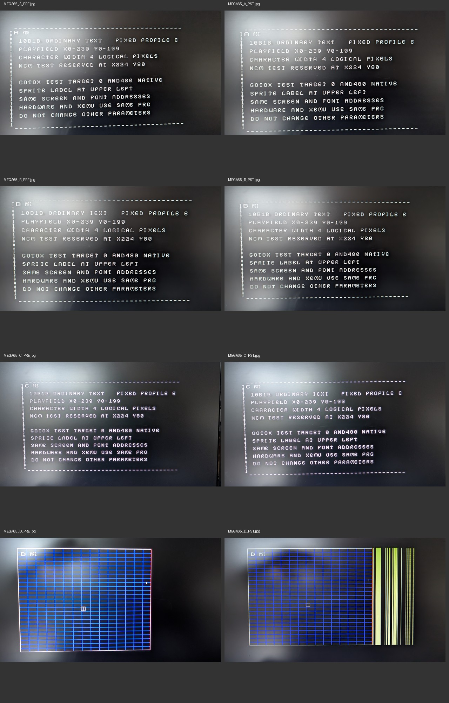
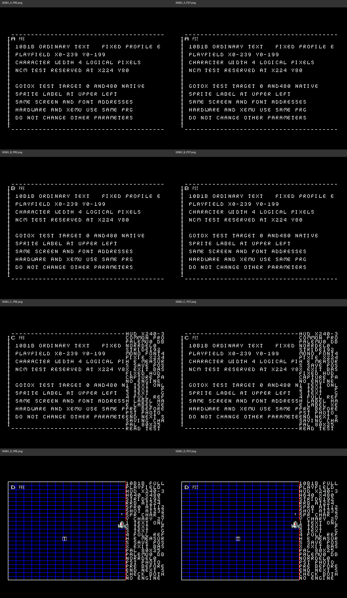

# Stage10b1b: Hardware- und XEMU-Auswertung vom 17.10.2026

Die Uploads bestätigen einen sichtbaren Hardware-/XEMU-Unterschied in C/D,
aber noch keine eindeutige Ursache. Zusätzlich wurde eine falsche Breitenannahme
im Diagnoseaufbau nachgewiesen: A/B platzieren HUD und Pixie außerhalb des
sichtbaren Bereichs. Das fehlende HUD in A/B ist daher kein Hardwarebeweis.
Der Build bleibt unverändert; diese Auswertung korrigiert seine Interpretation.
Keine Änderung an Stage10a1, kein neuer Build, kein Stable oder Merge.

## Quellen und Validierung

Alle sechs Originaluploads sind unverändert unter
[inputs](diagnostics/stage10b1b/hardware_20261017/inputs) gesichert:
vier D81, acht Hardwarefotos in `MEGA65_A_to_D.zip` und acht XEMU-PNGs in
`XEMU_A to D.zip`. Herkunft laut Benutzer; H/X im Header allein ist kein
Hardwarebeweis. Zielbedingungen aus dem bestehenden Auftrag: Core0.97 aaf4542,
XEMU20260129235930, ROM V920413, PAL80×25. Fotos bestätigen nicht selbst die
Versionsnummern. Die neuen XEMU-Uploads ersetzen für diesen Vergleich die nur
ergänzenden lokalen Headless-Belege.

- Alle vier PRGs sind byteidentisch zum veröffentlichten Stage10b1b-PRG.
- Je Plattform: Image1 enthält A1/B2/C3/D4, jeweils PRE/PST; Image2 enthält
  B2 und das zurückgekehrte A3. Insgesamt24 Schnappschüsse, zwölf gültige Paare.
- Alle Schnappschüsse:40408Bytes, gültige Magic/Version, vollständige
  162Register-/13Regionen-Verzeichnisse, gültige CRC16, korrekte Szenen-/Phasenmarker,
  Exportfehler0 und bestandene explizite Profil-E-Konfigurationsprüfungen.
- In jedem der zwölf PRE/PST-Paare: **0 unerklärte Speicherbyteänderungen**.
  Nur die vorgesehenen Phasenmarker ändern sich; keine Palettenänderung.
- Hardware jeweils `$D62D:7F→FF`, sonst keine Unterschiede im vom bisherigen
  Skript als stabil eingestuften Registeranteil. XEMU: auch dort keine Änderung.
  `$D62D` ist kein VIC-IV-Register. Der konservative Vergleich führt es weiter
  ungekürzt auf; der Wertwechsel ist kein Nachweis einer Renderingursache.

Prüfsummen, Originaldateinamen, extrahierte Rohdaten und vollständige Vergleiche:
[results.json](diagnostics/stage10b1b/hardware_20261017/results.json).
Die generischen JSON-Schlüssel `stable_bucket_differences` und
`unexpected_stable_register_differences` sind mechanische Maskenvergleiche,
keine automatisch bewiesenen Fehler oder ausschließlich VIC-IV-Konfigurationen.

## Was die Bilder zeigen

| Szene | XEMU PRE/PST | Hardware PRE/PST | Belastbare Einordnung |
|---|---|---|---|
| A | Linker Text, kein rechtes HUD | Linker Text, kein rechtes HUD | Beide durch falsche Mono-Breitenannahme betroffen |
| B | Wie A, NCM-Pixie nicht sichtbar | Wie A, NCM-Pixie nicht sichtbar | B-Pixie liegt rechnerisch offscreen; kein Transparenznachweis |
| C | HUD rechts sichtbar, Text überlagert/abgeschnitten | Rechtes HUD fehlt | Unterschied bereits mit GOTOX ohne NCM vorhanden |
| D | Raster, HUD und farbiger NCM-Pixie sichtbar | Raster, kein lesbares HUD/NCM-Pixie; PST zusätzlich gelbe senkrechte Bänder rechts | Hardwaredarstellung ändert sich nach Export trotz gleicher erfasster Quelldaten |

Die Hardwarefotos haben Perspektive, Reflexion und unterschiedliche Belichtung;
keine Pixel-für-Pixel-Fotomessung. PRE/PST-Marker sind lesbar. D-PST ist keine
versehentlich als POST verwendete END-Aufnahme. Die sichtbaren weißen kleinen
Konturen allein werden nicht als korrekt gerenderter Originalpixie gewertet.
Die XEMU-Darstellung bleibt zwischen PRE und PST abgesehen vom Marker stabil.





## Nachgewiesener Fehler der Diagnosegeometrie

Bei H640 und D05A=60 wird der Glyphquellindex um60/120=0,5 pro ausgegebenem
nativen Pixel weitergeschaltet. Ein normales8Pixel-Monoglyph benötigt daher
**16 native Pixel (=8 logische Spielpixel)**. Ein16Pixel-NCM-Glyph benötigt
32native Pixel (=16logische). Der Builder hatte Mono fälschlich mit8nativen
Pixeln angesetzt. Auch der eingeblendete Text „CHARACTER WIDTH 4 LOGICAL PIXELS“
ist falsch; er stammt aus dieser Annahme.

Nachvollziehbare Grundlage:
[Core aaf4542, viciv.vhdl Zeilen5588ff](https://github.com/MEGA65/mega65-core/blob/aaf4542d02679271b5fb84ad933cc39bbe091c3f/src/vhdl/viciv.vhdl#L5588):
H640 nutzt den Skalenwert direkt, Quellindexfortschritt beim Erreichen von120.
Die vorliegenden XEMU-Bilder bestätigen16native Pixel pro Monozelle; im lokal
vorhandenen XEMU-Code `vic4.c` berechnen `calculate_char_x_step` und die
Monoglyph-Schleifen ebenfalls0,5 und geben pro Schleifendurchlauf einen Pixel aus.
Diese zusätzliche Codeinspektion ist keine Behauptung über die exakte Revision
des vom Benutzer verwendeten XEMU-Binaries.

Daraus folgen, jeweils relativ zur CHARX-Ursprungsposition:

- A-HUD:60Monozellen×16=960native Pixel; außerhalb des640Pixel-Sichtbereichs.
- B-Pixie:56×16=896native Pixel (logisch448, nicht224).
  Danach HUD bei896+32=928native Pixel, ebenfalls außerhalb.
- C erzwingt mit GOTOX480 die HUD-Position. Die vorherigen60Monozellen wären
  ohne GOTOX960Pixel breit; das ist keine saubere80Spalten-Textreferenz.
- D erzwingt den HUD-Beginn ebenfalls bei480.20Monozellen benötigen320Pixel,
  im160Pixel breiten HUD können höchstens zehn vollständig sichtbar sein.
  Das erklärt den beschnittenen HUD-Text in XEMU, aber nicht dessen vollständiges
  Fehlen auf der Hardware oder die gelben Hardware-PST-Bänder.

Korrigierte nominelle Ausgabepixel-Summen vor Clipping/GOTOX-Überlagerungen:
A1536, B-Sonderzeilen1552, C1504, D1728. Formel Mono×16+NCM×32.
Die im unveränderten Release gespeicherten alten Felder
`nominal_native_pixel_work` sind deshalb keine korrekten nativen Summen.
Eintragszahlen96, Screen-/Color-Bytes192 und Glyph-Row-Payload bleiben korrekt.
Auch die korrigierten Summen sind **keine gemessenen FPGA-Zyklen oder bewiesenen
Rasterbudgetgrenzen**; GOTOX, Guards, Pipeline und Clipping werden nicht dadurch
zu einem bestimmten Zeitmodell.

## Register- und Speichervergleich Hardware gegen Benutzer-XEMU

Alle zwölf gleichnamigen plattformübergreifenden PRE-/PST-Vergleiche sind separat
als `*_USER_XEMU_HARDWARE_*.json` abgelegt. Frühere Dateien ohne `USER` im Namen
bleiben ausdrücklich ergänzende lokale XEMU-Vergleiche.

- Die ausgewertete Bildschirmgeometrie ist gleich. Screen, sichtbares Color-RAM,
  Font, Rasterglyphen, Pixie, Spritegrafiken, Pointer, beide Guards und zusätzliche
  Screenzeile sind jeweils bytegleich. D051-Schreibwert1F, NORRDEL0, DBLRR0,
  PALEMU0, H640, Scale60/1, Count96, Stride192 stimmen überein.
- Palettenrücklesung:1264Byte unterscheiden sich plattformübergreifend.
  Die ausdrücklich initialisierten Einträge sind dagegen alle gleich:
  Bank1 Indizes0/1,16–31,48–51 sowie Bank2 Index1. Abweichungen liegen in
  übernommenen, nicht initialisierten Einträgen; PRE/PST ändert sie nicht.
  Die vier vollständigen Banken bleiben im Rohvergleich sichtbar.
- Die nicht initialisierte zusätzliche Color-Zeile nach den25sichtbaren Zeilen
  unterscheidet sich in191von192Bytes. Sie bleibt innerhalb jeder Plattform und
  PRE/PST gleich. Ob die Pipeline solche Randdaten tatsächlich benutzt, ist offen.
- Drei Schreibschattenbytes unterscheiden sich: D051-Restorewert, beim Eintritt
  gelesener D07A-Wert und daraus abgeleiteter D07A-Schreibwert. Das sind
  dokumentierte Unterschiede der Startzustände, keine veränderten NCM-Daten.
- Register u.a. D053.7 (Spiegel des Rastervergleichsquellenmodus), D079 (IRQ-
  Vergleich), D07A (XEMU00/Hardware88: Quellmodus und kontinuierliche
  Spritepointerüberwachung), D067 (im Core als Debugregister bezeichnet) sowie
  diverse Peripherie-/Identitätsregister sind nicht gleich. Diese Befunde dürfen
  nicht hinter der zutreffenden Aussage „Geometrie gleich“ verschwinden.

Insbesondere D07A wird im vorhandenen Diagnoseprogramm aus dem Startzustand
übernommen und nur CHARY16 gelöscht; es ist nicht plattformübergreifend komplett
normalisiert. Das ist eine noch zu isolierende Kontrollvariable. Eine
Kausalbehauptung für das HUD oder ein blindes Zurückschreiben von Debug-/IRQ-
Readbacks ist daraus nicht gerechtfertigt.

## A→B→A und Grenzen der Schlussfolgerung

Beide zweiten Images enthalten das **letzte A mit Sequenz3**, B mit Sequenz2.
Das erste A derselben Folge wurde durch die festen A-Dateinamen überschrieben.
Deshalb ist ein vollständiger innerhalb derselben Sitzung dokumentierter
A1→B2→A3-Vergleich nicht möglich; für A3 gibt es auch kein eigenes Foto.
Der Vergleich mit A1 aus Image1 liefert bei beiden Plattformen gleiche stabile
Register und sämtliche gleichen Bildregionen; nur das Sequenz-Schattenbyte
unterscheidet sich. Kein nachweisbarer dauerhafter B-Speicherrückstand in A3.
Die Bildwiederherstellung von A3 ist damit nicht visuell bewiesen.

Gleiche lesbare Register und Daten schließen einen internen Renderer-/FIFO-/
Zeigerzustand, einen zeitabhängigen Initialisierungseffekt oder einen nicht
mitgeschnittenen Zustand nicht aus. Der H/E-Pfad enthält BASIC-Restore, KERNAL-
Datei-I/O und erneuten Szenenaufbau; die Fotos isolieren daher **den gesamten
Export-/Wiederaufbaupfad**, nicht allein einen einzelnen KERNAL-Schreibaufruf.
C zeigt, dass NCM-Mischung für den sichtbaren Hardwareunterschied nicht notwendig
ist. Eine harte96Eintragsgrenze, NORRDEL als Ursache oder Speicherbeschädigung
sind mit diesen Daten nicht bewiesen.

## Reproduktion und kleinster sinnvoller Folgetest

```sh
python tools/analysis/analyze_stage10b1b_hardware.py
# Optional unabhängige Ausgabe, ohne bestehende Berichte zu ersetzen:
python tools/analysis/analyze_stage10b1b_hardware.py --output /tmp/stage10b1b-results
```

Standardbibliothek genügt. Das Skript prüft alle Dateiketten beim Extrahieren,
Signaturen, CRC, Profilwerte, Marker und Programmidentität, erzeugt Rohdateien,
vergleicht zwölf PRE/PST-Paare und zwölf Benutzer-XEMU-/Hardware-Paare und
inventarisiert die beiden Bildarchive mit SHA256. Es erstellt keinen Build.

Vor einem produktiven Fix empfehle ich einen weiteren isolierten Test:
korrekte Mono-Abstände und kurze HUD-Zeilen, feste sichtbare GOTOX-Ziele bei
reduzierter Eintragszahl, kontrollierte Startwerte für die tatsächlich relevanten
D07A-Bits sowie getrennte Schritte für Wiederaufbau ohne I/O und Export mit
Wiederaufbau. Die Randzeile sollte dann bewusst initialisiert und als weitere
Variable getrennt getestet werden. Das ist ein Vorschlag, noch keine Umsetzung
und insbesondere kein Stage10b2-Auftrag.
